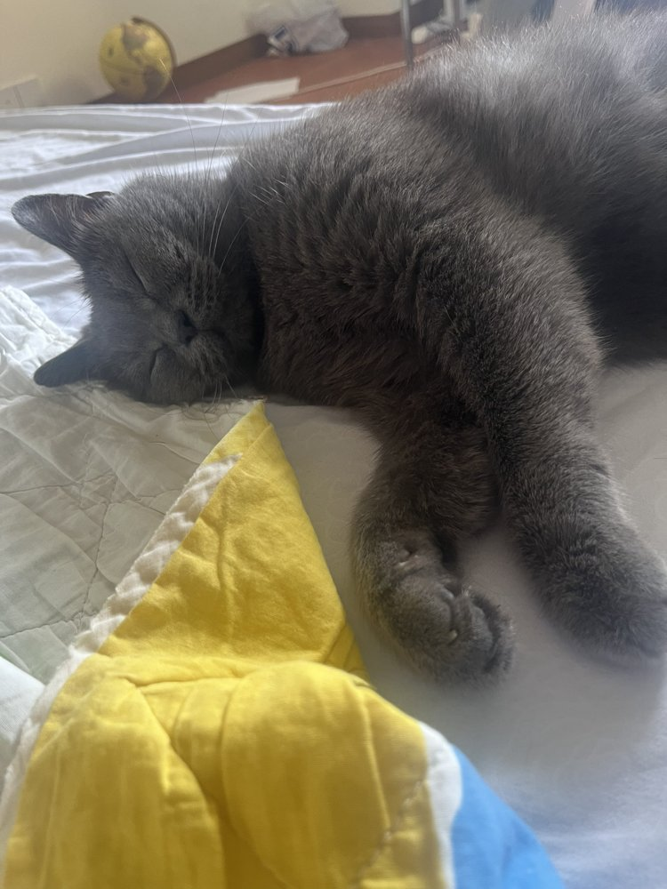

# Template Bounds and Recovery Obligations for IUT III, Corollary 3.12

*manchichi (pseudonym)*

*Contact: manchichi777@gmail.com*

*Public discussion draft, v1.0 — 17 November 2026*

*Feedback: please send comments to the contact above, identifying the statement, page, and proposed correction.*

## Abstract

We study an explicit system of local lattices, comparison maps, and regions motivated by the log-volume comparison in IUT III, Corollary 3.12. The assumptions of the system are stated separately from the question whether it describes the actual IUT construction. Its template region includes every prescribed row and comparison representative, followed by the specified two group actions. We prove bounds for its normalized log-volume, including an explicit correction for non-uniform fibres, and show that longer words in those two actions do not enlarge the template. For uniform fibres, the lower-bound inequality reduces to a comparison between the excess of the actual output over the template and an explicitly bounded deficit. A second result gives a lower bound for the ideal hull of transported unit tensors, conditional on their membership in the output. These results identify distinct membership, coverage, and arithmetic obligations. They neither prove nor refute Corollary 3.12.

**In plain terms.** This paper separates a comparison inequality into a part that can be bounded within an explicit model and a part whose realization by the original construction remains unconfirmed. The main open task is to identify which transported points belong to the actual output and which estimates cover that entire output.

## 1. Introduction and main results

Corollary 3.12 of [III] supplies the lower-bound input used with the upper estimates in [IV, Theorem 1.10] to obtain its final arithmetic inequality. The validity of the comparison is the subject of public disagreement between Scholze–Stix [SS] and Mochizuki [MR, MC]. This paper takes no position on that disagreement.

The inequality considered here is

$$L_\Theta\ge L_q. \tag{LB}$$

In the intended application, $L_\Theta$ is the normalized log-volume of the hull of the union of possible images of a theta-pilot object, and $L_q$ is the corresponding q-pilot value. Both values must be read in the same target coordinates and with the same normalization. This paper separates three questions: what follows from specified lattice transports; which transported points belong to the actual output; and what bounds cover that entire output.

The distinction is necessary in both directions. An upper bound for a subregion is not an upper bound for the full output. Conversely, a set lying in a common ambient space need not contribute points to the output being measured. We therefore formulate the mathematical results in a comparison system with explicit hypotheses. Identifying this system with the construction of [III] is a separate question, discussed in Section 7.3.

We retain $l\ge7$ for the intended arithmetic application. The abstract lattice, permutation, and recovery statements of Sections 2–5 and 7 use only that $l$ is an odd prime. Set

$$l^*=(l-1)/2,\qquad w_j=1/l^*,\qquad k_l=\sum_{j=1}^{l^*}w_jj^2=l(l+1)/12. \tag{1.1}$$

For non-negative local parameters $r_v$ and positive fibre weights $\alpha_v$ summing to one, put

$$a_q=\sum_p\sum_{v\in V_p}\alpha_vr_v\log p,\qquad L_q=-a_q. \tag{1.2}$$

Only finitely many $r_v$ are non-zero. An input is **fibre-uniform** if $r_v$ is constant on each $V_p$. In the intended arithmetic interpretation, $r_v$ is the valuation of the specified $2l$-th root of a Tate parameter at a selected bad place, and zero elsewhere. If the field of moduli is $\mathbb Q$, every fibre has one element and is uniform.

The template $U_{\rm tmp}$ is defined in Section 3. Its hull reading is denoted by $M$. The quantities $E_{\rm tmp}$, $G_{\rm perm}$ and $E_{\min}$ are explicit finite sums defined in Section 4.

**Theorem A (template bounds).** Assume the local data of Section 2, (T1)–(T5), and the quoted local estimate (2.8); (T6) is not required. Then the template reading is finite and

$$-k_la_q+G_{\rm perm}\le M\le-k_la_q+G_{\rm perm}+E_{\min}. \tag{1.3}$$

Here $0\le G_{\rm perm}\le k_la_q$, and $G_{\rm perm}=0$ exactly on the fibre-uniform domain. On that domain, $E_{\min}=E_{\rm tmp}$ and

$$-k_la_q\le M\le-k_la_q+E_{\rm tmp}. \tag{1.4}$$

The template is unchanged by arbitrary finite words in the two specified group actions. Neither an output-membership hypothesis nor an actual-output coverage hypothesis is needed for these conclusions.

**Theorem B (conditional recovery criterion).** Suppose, in addition, that the template is contained in an output region $U_{\rm out}$ whose reading $L_\Theta$ is finite. On the fibre-uniform domain set

$$\Gamma=L_\Theta-M,\qquad\delta=L_q-M. \tag{1.5}$$

Then $\Gamma\ge0$, and

$$L_\Theta\ge L_q\quad\Longleftrightarrow\quad\Gamma\ge\delta,\qquad
(k_l-1)a_q-E_{\rm tmp}\le\delta\le(k_l-1)a_q. \tag{1.6}$$

The equivalence itself is elementary; its content lies in the independent bounds for $M$.

A further local theorem concerns transported tensors of units. It gives an ideal-hull lower bound depending on the local fields, and an explicit condition under which these tensors escape the template hull. Whether they belong to the actual output is discussed in Section 5. Proposition 3.3 shows that, in the standard realization of [II, Example 1.8(iv)], the finite-place part of (Ind2) acts on each tensor factor by unit scalars, which is the form assumed in (T3).

The paper is organized around these dependencies. Sections 2–4 give the objects and prove Theorem A. Section 5 treats unit tensors. Section 6 records the arithmetic budget and non-uniform diagnostics. Section 7 proves Theorem B and states the remaining certification obligations. Appendix A lists sources and gives a correspondence dictionary; Appendix B sketches an arithmetic construction of non-uniform inputs; Appendix C compares our definitions with [DH20]; Appendix D audits the quoted arithmetic estimates.

### 1.1. Related work

Dupuy–Hilado's 2020 article [DH20] treats initial theta data and the first two indeterminacies without claiming a proof of Corollary 3.12. Its 2025 replacement [DH25] treats initial theta data; the arXiv record announces a separate first-two-indeterminacies paper [DH2]. Appendix C compares our definitions with the 2020 text.

Dupuy–Hilado [DHS] derive Szpiro-type inequalities from their formulation of Corollary 3.12 and additional stated assumptions.

Scholze–Stix [SS] and Mochizuki [MR, MC] give conflicting analyses of the comparison in Corollary 3.12. Joshi [J] announces a proof in a theory of arithmetic Teichmüller spaces and a correspondence with IUT. We do not evaluate these works, and none of their conclusions is used here.

## 2. Local data, ideal hulls, and normalization

### 2.1. Local fields and blocks

For each rational prime $p$, let $V_p$ be a non-empty finite set, with weights $\alpha_v>0$ such that $\sum_{v\in V_p}\alpha_v=1$. To $v$ attach a finite extension $K_v/\mathbb Q_p$. Normalize its valuation by $\operatorname{ord}_p(p)=1$ and write $e_v$ for its ramification index. We require

$$r_v\in e_v^{-1}\mathbb Z_{\ge0}. \tag{2.1}$$

Let $S$ be a finite set of primes containing every prime at which some $r_v$ is non-zero. At primes outside $S$ the template will be fixed by the tail assumption below. The intended arithmetic choice is the set of rational primes ramified in the field denoted by $K$ in [I, Definition 3.1]. The present theorems require the stated support property explicitly.

For $1\le j\le l^*$ put $n=j+1$. A block is a tuple $\mathbf v=(v_0,\ldots,v_j)\in V_p^n$. Define

$$E_{\mathbf v}=\bigotimes_{i=0}^jK_{v_i}=\prod_\nu K_\nu,\quad
\widetilde R_{\mathbf v}=\prod_\nu\mathcal O_{K_\nu},\quad
L_{\mathbf v}=\bigotimes_{i=0}^j\log(\mathcal O_{K_{v_i}}^\times),\quad
\omega_{\mathbf v}=\prod_{i=0}^j\alpha_{v_i}. \tag{2.2}$$

Field tensor products are over $\mathbb Q_p$, lattice tensor products over $\mathbb Z_p$. The latter are viewed inside the former. The p-adic logarithm of the unit group is a full lattice. Each factor $K_\nu$ receives an embedding of every $K_{v_i}$.

Set

$$d_v=\operatorname{ord}_p(\mathfrak D_{K_v/\mathbb Q_p}),\quad
a_v=e_v^{-1}\lceil e_v/(p-2)\rceil\ (p>2),\quad a_v=2\ (p=2),\quad
b_v=\lfloor\log_p(pe_v/(p-1))\rfloor-e_v^{-1}. \tag{2.3}$$

Let $m_v$ be the minimum valuation of a non-zero element of $\log(\mathcal O_{K_v}^\times)$. This minimum exists because the lattice is compact and open. For a block, use sums of the corresponding constants:

$$d_{\mathbf v}=\sum_i d_{v_i},\quad a_{\mathbf v}=\sum_i a_{v_i},\quad
b_{\mathbf v}=\sum_i b_{v_i},\quad s_{\mathbf v}=\sum_i m_{v_i},\quad
f_{\mathbf v}=\sum_i\lfloor m_{v_i}\rfloor. \tag{2.4}$$

Finally put

$$\lambda_{\mathbf v,i}=j^2r_{v_i},\quad\lambda_{\mathbf v}=\lambda_{\mathbf v,j},\quad
\mu_{\mathbf v}=\min_i\lambda_{\mathbf v,i},\quad
t_{\mathbf v}(x)=\lfloor x-d_{\mathbf v}-a_{\mathbf v}\rfloor. \tag{2.5}$$

### 2.2. Valuation thresholds and a necessary integrality convention

For a real $h$, write $I_{\mathbf v}(h)$ for the set of elements whose components all have valuation at least $h$. If the component $K_\nu$ has ramification index $e_\nu$, its actual ideal exponent is

$$h_\nu=\lceil e_\nu h\rceil/e_\nu. \tag{2.6}$$

Consequently, a general real threshold must not be treated as an exact scalar exponent. For normalized logarithmic Haar volume,

$$\mu_{\mathbf v}^{\log}(I_{\mathbf v}(h))
=-\sum_\nu\varepsilon_\nu h_\nu\log p,\qquad
\varepsilon_\nu=[K_\nu:\mathbb Q_p]/\dim_{\mathbb Q_p}E_{\mathbf v}. \tag{2.7}$$

When $h$ belongs to every component value group, we abbreviate this ideal as $p^h\widetilde R_{\mathbf v}$; its log-volume is exactly $-h\log p$. This applies to each seed exponent in (2.5), by (2.1), and to $s_{\mathbf v}$ and its integral translates. For example, the set of elements of $\mathbb Q_p$ of valuation at least $1/2$ is $p\mathbb Z_p$, of log-volume $-\log p$, not $-(1/2)\log p$.

**Local estimate (quoted).** At the seed exponents $\lambda\in e_{v_i}^{-1}\mathbb Z$ used here, [IV, Proposition 1.2(ii), Proposition 1.4(iii), pp.10, 13] gives

$$p^\lambda\widetilde R_{\mathbf v}\subseteq p^{t_{\mathbf v}(\lambda)}L_{\mathbf v},\qquad
L_{\mathbf v}\subseteq p^{-b_{\mathbf v}}\widetilde R_{\mathbf v}. \tag{2.8}$$

The second exponent is admissible in every component.

**Lemma 2.1 (hull of the logarithm lattice).** The smallest product of fractional ideals containing $L_{\mathbf v}$ is $p^{s_{\mathbf v}}\widetilde R_{\mathbf v}$. In particular, $s_{\mathbf v}\ge-b_{\mathbf v}$.

*Proof.* A pure tensor has, in every field component, valuation equal to the sum of the valuations of its factors. These valuations are at least $m_{v_i}$. Choosing a factor attaining each minimum gives a pure tensor with valuation exactly $s_{\mathbf v}$ in every component. Every lattice element is a finite $\mathbb Z_p$-linear combination of pure tensors, so the lower bound persists. The asserted hull follows component by component. The last inequality follows from (2.8). □

### 2.3. Regions and readings

Let $E_{j,p}$ be the direct sum of the block spaces over $V_p^{j+1}$. A finite-place region is a subset of $E_{j,p}$. Its ideal hull is the product of the smallest component ideals containing its projections, whenever these are proper non-zero fractional ideals. Thus a hull may combine projections coming from different records, even when those records cannot be chosen simultaneously.

Normalize Haar measure on a block by giving $\widetilde R_{\mathbf v}$ measure one. Its normalized logarithmic volume is the logarithm of that measure divided by $\dim_{\mathbb Q_p}E_{\mathbf v}$. At infinity use products of discs and the degree normalization of [IV, Proposition 1.5]; the product $B_\infty$ of unit discs has reading zero. For a family of regions with proper local hulls and only finitely many non-zero local readings, define

$$\mathcal L(U)=\sum_{j=1}^{l^*}w_j\left(
\sum_p\sum_{\mathbf v\in V_p^{j+1}}\omega_{\mathbf v}
\mu_{\mathbf v}^{\log}(\operatorname{Hull}(U_{j,p})_{\mathbf v})
+\mu_\infty^{\log}(\operatorname{Hull}(U_{j,\infty}))\right). \tag{2.9}$$

This is the procession normalization used throughout. There is no further factor $1/(j+1)$. The monotonicity needed below follows directly from component ideal containment: if $U\subseteq U'$ and both readings are defined, then $\mathcal L(U)\le\mathcal L(U')$. The analogous source construction is discussed in [III, Proposition 3.9 and Remark 3.9.5, pp.115–117, 127–130].

## 3. The comparison system and the template

### 3.1. Explicit transport hypotheses

The following are hypotheses on a comparison system. Their intended relationship with IUT is recorded in Appendix A. An application to IUT must verify them for one common input, background, target coordinates, and family of comparisons.

**(T1) Records and lattice transport.** A record $r=(z,\kappa,g_1,g_2)$ consists of a row $z$, a prescribed comparison representative $\kappa$, and elements of two specified groups $G_1,G_2$. For a target block $\mathbf v$, let $\sigma$ be the label permutation of $g_1$ and put $u_i=v_{\sigma(i)}$. The record gives a $\mathbb Q_p$-linear isomorphism

$$\Psi_{r,\mathbf v}:E^{\rm src}_{\mathbf u}\longrightarrow E_{\mathbf v},\qquad
\Psi_{r,\mathbf v}(L^{\rm src}_{\mathbf u})=L_{\mathbf v}. \tag{3.1}$$

The source block is a copy of the tensor product of these same local fields and logarithm lattices, in the permuted order. In particular, the canonical permutation identifies the source and target integral normalizations and their normalized lattice volumes. This last compatibility is required for the calibration below; an isomorphism between two unspecified lattices alone would not suffice. No $\Psi_{r,\mathbf v}$ is assumed to be a ring homomorphism.

**(T2) Labels and records.** Every permutation of the $j+1$ labels occurs. The multiplier travels with its source label, so that the source seed for a record is

$$J^{\rm src}_{\mathbf u}=p^{j^2r_{u_j}}\widetilde R^{\rm src}_{\mathbf u}. \tag{3.2}$$

There is no additional independent permutation of the places. All rows and all prescribed representatives are included. Identity group elements are allowed.

**Source check for (T2).** [I, Definition 4.1(iv), p.96] keeps prime-strip morphisms indexed by the same places. The capsule convention [I, Section 0, pp.33–34] allows index bijections; Definition 4.10, pp.119–120, defines processions by capsule-full poly-morphisms. Proposition 6.9, pp.169–170, specifies the sets $\{0,\ldots,j\}$ and the label indeterminacies, whereas [III, Proposition 3.4(ii), pp.102–103] places the LGP multiplier at label $j$. These support the combinatorial ingredients of (T2). That every record in (T2), with its transport and seed, is an image of the actual algorithm on non-uniform fibres is part of our transcription.

**(T3) Actions.** On finite-place tensor factors, $G_1$ acts by label permutations and $\mathbb Q_p$-linear factor isomorphisms. The group $G_2$ is the specified product of scalar groups $\mathbb Z_p^\times$ indexed by the factors; Proposition 3.3 derives this scalar form from the definition of $\operatorname{Ism}$. Both actions are represented through the same comparison, so that postcomposition agrees with composition in these groups. This compatibility is part of the record system. More explicitly, let $h$ be a finite word in $G_1,G_2$, let $\tau_h$ be its induced permutation of target blocks, and let $h_{\mathbf v}:E_{\mathbf v}\longrightarrow E_{\tau_h(\mathbf v)}$ be its block map. If $hg_2g_1=g'_2g'_1$, the required identity is

$$h_{\mathbf v}\bigl(A_{(z,\kappa,g_1,g_2),j,p,\mathbf v}\bigr)
=A_{(z,\kappa,g'_1,g'_2),j,p,\tau_h(\mathbf v)}. \tag{3.1a}$$

Here $A_{r,j,p,\mathbf v}$ denotes the block projection of the record image defined below. This is an assumption about the specified common comparison.

**(T4) Tails.** Outside $S$, every record image is the product of the rings of integers of the blocks. At infinity every record image is $B_\infty$, and each prescribed action preserves this region.

**(T5) Readings.** Formula (2.9) is used on source and target, with the same weights and root normalization. The q-value is $L_q=-a_q$.

Let $A_r$ denote the family of images (3.2) under a record, together with its prescribed tails. Define

$$U_{\rm tmp}=\bigcup_r A_r,\qquad H_{\rm tmp}=\operatorname{Hull}(U_{\rm tmp}),\qquad
M=\mathcal L(U_{\rm tmp}). \tag{3.3}$$

Unions and inclusions are taken at each $(j,p)$. Finiteness of $M$ will be proved, not assumed. The definition contains no operation attributed to (Ind3) and no extra iteration of a log-link on a pilot region.

**(T6) Output membership, when invoked.** There is an output family $U_{\rm out}$, with a defined reading $L_\Theta$, such that $A_r\subseteq U_{\rm out}$ for every record. Hence $U_{\rm tmp}\subseteq U_{\rm out}$.

In the intended application $U_{\rm out}$ is the region of [III, Corollary 3.12]; the comparison system itself does not identify the two.

### 3.2. Two structural lemmas

**Lemma 3.1 (absorption of words).** Under (T3), $G_1$ normalizes $G_2$. Every finite word in these two groups is of the form $g_2g_1$. Consequently, the template is invariant under such words.

*Proof.* If $u$ is one of the factor isomorphisms and $c\in\mathbb Z_p^\times$, then $ucu^{-1}=c$ because $u$ is $\mathbb Q_p$-linear. Conjugation by an element of $G_1$ therefore re-indexes the scalar family along its label permutation. This gives $g_1G_2g_1^{-1}=G_2$. Moving scalar factors to the left reduces any finite word to $g_2g_1$. By the postcomposition identity (3.1a) in (T3), the result is another record with the same row and representative. This identity is the only postcomposition compatibility used here. At infinity the assertion follows from (T4); no archimedean operator normal form is claimed. □

**Lemma 3.2 (measure calibration).** The source seed reading is $-k_la_q$. Moreover,

$$\mu_{\mathbf v}^{\log}(\operatorname{Hull}(\Psi_{r,\mathbf v}(J^{\rm src}_{\mathbf u})))
\ge-j^2r_{u_j}\log p. \tag{3.4}$$

*Proof.* The exponent in (3.2) is admissible by (2.1), so its normalized log-volume is $-j^2r_{u_j}\log p$. Summing the tuple weights over the other $j$ entries leaves $\alpha_{u_j}$. Summation over $j,p,u_j$ gives (1.1)–(1.2).

For the image, first identify source and target by the canonical permutation of the field factors. This identifies their normalized integral lattices and their logarithm lattices. Relative to this identification, $\Psi_{r,\mathbf v}$ is a linear automorphism preserving the full lattice $L_{\mathbf v}$; its determinant has p-adic absolute value one. Thus it preserves Haar measure with the normalization of Section 2.3. Taking the hull can only increase volume. □

Since $\Psi_{r,\mathbf v}$ is not a ring homomorphism, the image of an ideal need not be the ideal of the same name in the target.

### 3.3. The scalar form of (Ind2)

The group $G_2$ of (T3) transcribes the finite-place part of (Ind2). By [III, Theorem 3.11(i), p.154], independent copies of $\operatorname{Ism}$ act on the direct summands of the tensor factors, and [III, Proposition 1.2(vi), p.32] refers for $\operatorname{Ism}$ to [II, Example 1.8(iv), p.39]. There, for a profinite group $G$ of the relevant type, $\operatorname{Ism}(G)$ is the group of $G$-equivariant automorphisms of the ind-topological module $\mathcal O^{\times\mu}(G)$ that, for every open subgroup $H\subseteq G$, preserve the image of $\mathcal O^{\times}(G)^H$ in $\mathcal O^{\times\mu}(G)^H$. The definition contains the natural scalar group $\mathbb Z_p^\times$. We show that, in the standard realization, it contains nothing else.

Let $k$ be a finite extension of $\mathbb Q_p$, let $\bar k$ be an algebraic closure, and put $G_k=\operatorname{Gal}(\bar k/k)$. In the standard realization, $\mathcal O^{\times\mu}(G_k)=\mathcal O_{\bar k}^{\times}/\mu(\bar k)$, and for $H=G_F$ with $F/k$ finite in $\bar k$ one has $\mathcal O^\times(G_k)^H=\mathcal O_F^\times$; compare [II, pp.36–38]. The $p$-adic logarithm is a $G_k$-equivariant homomorphism $\mathcal O_{\bar k}^\times\to\bar k$ whose kernel is $\mu(\bar k)$. It is surjective: given $x\in\bar k$, choose $m$ with $p^mx$ in the domain of convergence of the exponential, put $u_0=\exp(p^mx)$, and let $u$ be a $p^m$-th root of $u_0$ in $\bar k$; then $u$ is a unit and $\log u=x$. Hence

$$\mathcal O^{\times\mu}(G_k)\ \xrightarrow{\ \sim\ }\ \bar k,\qquad
\bigl(\text{image of }\mathcal O_F^\times\bigr)\ \longmapsto\ L_F:=\log(\mathcal O_F^\times)\subset F=\bar k^{\,G_F}. \tag{3.5}$$

**Proposition 3.3 (scalar rigidity of $\operatorname{Ism}$).** Let $T$ be a $G_k$-equivariant additive automorphism of $\bar k$ such that $T$ and $T^{-1}$ are continuous on every finite subextension, and such that $T(L_F)=L_F$ for every finite subextension $F/k$ of $\bar k$. Then there is a unique $c\in\mathbb Z_p^\times$ with $T(x)=cx$ for all $x\in\bar k$. Conversely, multiplication by any $c\in\mathbb Z_p^\times$ has these properties. Consequently, in the standard realization (3.5),

$$\operatorname{Ism}(G_k)=\mathbb Z_p^\times\cdot\mathrm{id}. \tag{3.6}$$

*Proof.* *Step 1: layers.* For finite $F/k$ in $\bar k$, equivariance under $G_F$ gives $T(F)\subseteq F=\bar k^{\,G_F}$, and likewise for $T^{-1}$; so $T$ restricts to an additive automorphism $T_F$ of $F$. Being continuous and additive, $T_F$ is $\mathbb Q_p$-linear.

*Step 2: traces.* Let $F\subseteq E$ be finite subextensions. Every $F$-embedding $\sigma\colon E\to\bar k$ extends to an element of $G_F\subseteq G_k$, so $T$ commutes with $\operatorname{Tr}_{E/F}=\sum_\sigma\sigma$. Since $\log$ is an equivariant homomorphism and $N_{E/F}(u)=\prod_\sigma\sigma(u)$, one has $\log\circ N_{E/F}=\operatorname{Tr}_{E/F}\circ\log$ on $\mathcal O_E^\times$. Therefore

$$\operatorname{Tr}_{E/F}(L_E)=\log\bigl(N_{E/F}(\mathcal O_E^\times)\bigr),\qquad
T_F\bigl(\operatorname{Tr}_{E/F}(L_E)\bigr)=\operatorname{Tr}_{E/F}\bigl(T_E(L_E)\bigr)=\operatorname{Tr}_{E/F}(L_E). \tag{3.7}$$

*Step 3: every open sublattice is a trace lattice.* Let $M\subseteq L_F$ be an open $\mathbb Z_p$-submodule, and let $\pi_F$ be a uniformizer of $F$. Put $U_M=\{u\in\mathcal O_F^\times:\log u\in M\}$, an open subgroup of finite index in $\mathcal O_F^\times$ containing $\mu(F)$, and $N_M=\pi_F^{\mathbb Z}U_M$, an open subgroup of finite index in $F^\times$. By the local existence theorem of class field theory [Mi, Chapter I], there is a finite abelian extension $E/F$ in $\bar k$ with $N_{E/F}(E^\times)=N_M$. Since $\operatorname{ord}_F(N_{E/F}x)=f(E/F)\operatorname{ord}_E(x)$, an element of $E^\times$ whose norm is a unit is itself a unit. Hence

$$N_{E/F}(\mathcal O_E^\times)=N_{E/F}(E^\times)\cap\mathcal O_F^\times=N_M\cap\mathcal O_F^\times=U_M .$$

As $\log\colon\mathcal O_F^\times\to L_F$ is surjective and $U_M$ is a full preimage, $\log(U_M)=M$. By (3.7), $T_F(M)=M$ for every open $\mathbb Z_p$-submodule $M$ of $L_F$.

*Step 4: one layer.* Let $v\in L_F$ be primitive. The submodules $M_n=\mathbb Z_pv+p^nL_F$ are open, and $\bigcap_nM_n=\mathbb Z_pv$ because $\mathbb Z_pv$ is a direct summand. Applying Step 3 to $T_F$ and to $T_F^{-1}$ gives $T_F(\mathbb Z_pv)=\mathbb Z_pv$, so $T_F(v)=c_vv$ with $c_v\in\mathbb Z_p^\times$. For a basis $v_1,\dots,v_d$ of $L_F$ and $i\ne j$, the vector $v_i+v_j$ is primitive, and comparing $T_F(v_i+v_j)$ with $c_{v_i}v_i+c_{v_j}v_j$ gives $c_{v_i}=c_{v_j}$. Thus $T_F=c_F\cdot\mathrm{id}$ on $L_F$, hence on $F=\mathbb Q_pL_F$.

*Step 5: all layers.* If $F\subseteq E$, then $T_E$ restricts to $T_F$, so $c_E=c_F$. Any two finite subextensions lie in a third, so all $c_F$ equal a single $c\in\mathbb Z_p^\times$, and $T=c\cdot\mathrm{id}$ on $\bar k=\bigcup_FF$. Uniqueness is clear. Conversely, a unit scalar commutes with $G_k$, is continuous, and preserves every $\mathbb Z_p$-lattice. Under (3.5), the conditions on $T$ are exactly those defining $\operatorname{Ism}(G_k)$, which gives (3.6). □

**Remark 3.4 (scope and consequences).**

1. The group $G_k$ is fixed throughout. An automorphism of $G_k$, as may occur in (Ind1), moves the open subgroups and the corresponding lattices, so Steps 2–5 do not apply to it. Proposition 3.3 says nothing about $G_1$.
2. Applied to each factor $K_{v_i}$ of a block, with independent copies, Proposition 3.3 gives exactly the product of scalar groups specified in (T3). Thus the scalar form of $G_2$ follows from [II, Example 1.8(iv)], given the standard realization (3.5); for the realization see [II, pp.36–38].
3. If $[K_{v_i}:\mathbb Q_p]\ge2$, the group $\operatorname{Aut}_{\mathbb Z_p}(L_{K_{v_i}})$ is strictly larger than the restriction of $\operatorname{Ism}$. For example, with $k=K_{v_i}$ and $d=[k:\mathbb Q_p]$, choose a basis $e_1,\dots,e_d$ of $L_k$ and let $S$ fix every $e_r$ except $S(e_2)=e_2+e_1$. Then $S$ preserves $L_k$ but not the open submodule $M=p\mathbb Z_pe_1\oplus\mathbb Z_pe_2\oplus\cdots\oplus\mathbb Z_pe_d$, which is a trace lattice by Step 3. So $S$ is not the restriction of any element of $\operatorname{Ism}(G_k)$. The factorwise group $G_2'$ of Section 4.3 is therefore strictly larger than the finite-place part of (Ind2) in the standard realization.

## 4. Bounds for the template

### 4.1. Uniform fibres

On a uniform fibre write $r_p$ for the common value, $\lambda=j^2r_p$, and $t_{\mathbf v}=t_{\mathbf v}(\lambda)$. Define the fractional part by $\{x\}=x-\lfloor x\rfloor$ and put

$$E_{\rm tmp}=\sum_{p\in S}\sum_{j=1}^{l^*}w_j
\sum_{\mathbf v}\omega_{\mathbf v}
\left(d_{\mathbf v}+a_{\mathbf v}+b_{\mathbf v}
+\{j^2r_p-d_{\mathbf v}-a_{\mathbf v}\}\right)\log p. \tag{4.1}$$

**Proposition 4.1 (common container).** For every record and every block over $p\in S$,

$$\Psi_{r,\mathbf v}(J^{\rm src}_{\mathbf u})\subseteq p^{t_{\mathbf v}}L_{\mathbf v},\qquad
H_{{\rm tmp},\mathbf v}\subseteq p^{t_{\mathbf v}+s_{\mathbf v}}\widetilde R_{\mathbf v}
\subseteq p^{t_{\mathbf v}-b_{\mathbf v}}\widetilde R_{\mathbf v}. \tag{4.2}$$

*Proof.* Uniformity makes the seed exponent independent of the position of the multiplier. Permuting a tuple does not change the sums $d_{\mathbf v}$ and $a_{\mathbf v}$. Apply (2.8) in the source and then (3.1). Since $t_{\mathbf v}$ is an integer, the linear transport commutes with multiplication by $p^{t_{\mathbf v}}$. Every record image lies in the same target lattice. Its ideal hull is computed by Lemma 2.1. □

**Proposition 4.2 (uniform bounds).** Under (T1)–(T5), $M$ is finite and satisfies (1.4).

*Proof.* There are finitely many primes in $S$ and finitely many blocks at each of them. Each block projection of the template is bounded by (4.2) and contains a compact open seed image. Its hull is therefore a proper non-zero product of fractional ideals. The tails have reading zero by (T4), proving finiteness.

For the lower bound choose a record with trivial group elements and apply Lemma 3.2. For the upper bound use the last ideal in (4.2). Its reading is at most $(b_{\mathbf v}-t_{\mathbf v})\log p$. The identity

$$b_{\mathbf v}-t_{\mathbf v}=-j^2r_p+d_{\mathbf v}+a_{\mathbf v}+b_{\mathbf v}
+\{j^2r_p-d_{\mathbf v}-a_{\mathbf v}\} \tag{4.3}$$

and the weighted sum (1.1) give the result. □

**Proposition 4.3 (an inner ideal).** In the same situation set $v'=\lceil\lambda-s_{\mathbf v}\rceil+s_{\mathbf v}$. Then

$$\lambda\le v'<\lambda+1,\qquad
p^{v'}\widetilde R_{\mathbf v}\subseteq H_{{\rm tmp},\mathbf v}
\subseteq p^{t_{\mathbf v}+s_{\mathbf v}}\widetilde R_{\mathbf v}. \tag{4.4}$$

*Proof.* By Lemma 2.1, $p^NL^{\rm src}_{\mathbf v}$ is contained in the seed exactly when $N+s_{\mathbf v}\ge\lambda$. Take $N=\lceil\lambda-s_{\mathbf v}\rceil$ and a record with trivial permutation. Its image contains $p^NL_{\mathbf v}$. Taking the ideal hull proves the left inclusion; (4.2) gives the right one. □

### 4.2. Arbitrary fibres

For arbitrary data define

$$G_{\rm perm}=\sum_{j=1}^{l^*}w_j\sum_p\sum_{\mathbf v}\omega_{\mathbf v}
\left({1\over j+1}\sum_{i=0}^j\lambda_{\mathbf v,i}-\mu_{\mathbf v}\right)\log p, \tag{4.5}$$

$$E_{\min}=\sum_{p\in S}\sum_{j=1}^{l^*}w_j\sum_{\mathbf v}\omega_{\mathbf v}
\left(d_{\mathbf v}+a_{\mathbf v}+b_{\mathbf v}
+\{\mu_{\mathbf v}-d_{\mathbf v}-a_{\mathbf v}\}\right)\log p. \tag{4.6}$$

The factor $1/(j+1)$ in (4.5) belongs to a symmetrization identity within a block. It does not change the procession normalization (2.9).

**Proposition 4.4 (permutation bounds).** Under (T1)–(T5), (1.3) holds, $0\le G_{\rm perm}\le k_la_q$, and $G_{\rm perm}=0$ if and only if every fibre is uniform.

*Proof.* The tuple weights are invariant under permutations, so

$$-\sum_{j,p,\mathbf v}w_j\omega_{\mathbf v}\mu_{\mathbf v}\log p
=-k_la_q+G_{\rm perm}. \tag{4.7}$$

An average is at least a minimum. Equality in every positively weighted block occurs precisely when all its entries have the same $r$-value. Since all mixed tuples occur and $j+1\ge2$, this is exactly fibre-uniformity. The upper bound $G_{\rm perm}\le k_la_q$ follows from $\mu_{\mathbf v}\ge0$ and (4.7).

For the upper bound on $M$, every transported seed at $\mathbf v$ has exponent at least $\mu_{\mathbf v}$. Apply (2.8) at the admissible exponent $\mu_{\mathbf v}$; the common container is $p^{t_{\mathbf v}(\mu_{\mathbf v})}L_{\mathbf v}$. The proof of Proposition 4.2 now gives the upper bound and finiteness.

For the lower bound, fix one target block and choose a permutation placing an entry attaining $\mu_{\mathbf v}$ in the multiplier position. By Lemma 3.2 its seed image has log-volume $-\mu_{\mathbf v}\log p$. The projection of the template hull contains it. This choice may differ from block to block, since we are bounding projections of a union (Section 2.3). Sum and apply (4.7). □

Propositions 4.2 and 4.4, together with Lemma 3.1, prove Theorem A. All terms in (4.1) and (4.6) are non-negative: $d_v\ge0$, $a_v+b_v\ge0$, and fractional parts are non-negative.

### 4.3. Sensitivity to the choice of $G_2$

Theorems A and B retain the scalar group specified in (T3). The following alternative calculation concerns a larger, explicitly defined action. By Remark 3.4(3), when some factor has degree at least two over $\mathbb Q_p$, this action is strictly larger than the finite-place part of (Ind2) in the standard realization. The calculation therefore measures the sensitivity of the template to a different transcription of (Ind2), such as the tensor-block description of [DH20, Section 4.8] discussed in Appendix C.

**Proposition 4.5 (factorwise lattice-automorphism saturation).** Fix a finite-place block and write $L=\bigotimes_i L_i$, where $L_i=\log(\mathcal O_{K_{v_i}}^\times)$. Let $X\subset E_{\mathbf v}$ be bounded and contain a non-zero point. Put

$$G'_2=\prod_i\operatorname{Aut}_{\mathbb Z_p}(L_i),\qquad
t''=\max\{N\in\mathbb Z:X\subseteq p^N L\}. \tag{4.8}$$

The factors act on their rational spans and hence on their tensor product. Then

$$\operatorname{span}_{\mathbb Z_p}(G'_2X)=p^{t''}L,\qquad
\operatorname{Hull}(G'_2X)=p^{t''+s_{\mathbf v}}\widetilde R_{\mathbf v}. \tag{4.9}$$

*Proof.* Boundedness makes the set of integers in (4.8) non-empty, and a non-zero point bounds it above. Set $P=p^{t''}L$ and $\Lambda=\operatorname{span}_{\mathbb Z_p}(G'_2X)$. Since every group element preserves $P$, the submodule $\Lambda\subseteq P$ is stable under $G'_2$. Its image in $P/pP$ is non-zero by maximality of $t''$.

Each reduction map $\operatorname{Aut}_{\mathbb Z_p}(L_i)\longrightarrow\operatorname{GL}(L_i/pL_i)$ is surjective. The algebra generated by this finite general linear group is the full endomorphism algebra: in rank at least two, the matrices $1+E_{ab}$ give the off-diagonal matrix units, whose products give the diagonal ones. In rank one the identity already spans the endomorphism algebra, including when $p=2$. The product group therefore generates the full endomorphism algebra of $\bigotimes_i(L_i/pL_i)$. Its tensor representation is irreducible, so the non-zero image of $\Lambda$ is all of $P/pP$.

Thus $P=\Lambda+pP$. The quotient $P/\Lambda$ is a finitely generated $\mathbb Z_p$-module, so Nakayama's lemma gives $P=\Lambda$. No topological closure of the span is needed. An ideal region is a $\mathbb Z_p$-module; consequently a set and its $\mathbb Z_p$-span have the same ideal hull. Lemma 2.1 gives (4.9). The assertion requires no lower bound on the ranks other than positivity. □

**Corollary 4.6 (uniform template under $G'_2$).** Keep the same rows, representatives and seed transports as in (T1)–(T2). At each special finite block enlarge the allowed target postcompositions to all of $G'_2$, with the postcomposition compatibility (3.1a) for the enlarged records. Retain the tails of (T4). On a uniform fibre set $J_{\mathbf v}=p^\lambda\widetilde R_{\mathbf v}$, where $\lambda=j^2r_p$, and define $t''_{\mathbf v}$ by (4.8) for $X=J_{\mathbf v}$. Denote the resulting template reading by $M'$. Then

$$t_{\mathbf v}(\lambda)\le t''_{\mathbf v}\le\lfloor\lambda-s_{\mathbf v}\rfloor,\qquad
H'_{\rm tmp,\mathbf v}=p^{t''_{\mathbf v}+s_{\mathbf v}}\widetilde R_{\mathbf v}, \tag{4.10}$$

$$M'=-\sum_{p\in S}\sum_{j=1}^{l^*}w_j\sum_{\mathbf v}\omega_{\mathbf v}
(t''_{\mathbf v}+s_{\mathbf v})\log p. \tag{4.11}$$

*Proof.* By (2.8), $J_{\mathbf v}\subseteq p^{t_{\mathbf v}(\lambda)}L_{\mathbf v}$, giving the first inequality in (4.10). Inclusion in $p^{t''}L_{\mathbf v}$ implies inclusion in $p^{t''+s_{\mathbf v}}\widetilde R_{\mathbf v}$ by Lemma 2.1. The admissible seed has a point of valuation $\lambda$ in every component; hence $t''+s_{\mathbf v}\le\lambda$, giving the second inequality.

Canonical factor permutation identifies the source seed and lattice with these target objects. A transport satisfying (T1) preserves containment in each integral translate $p^N L$, in both directions. Every transported seed therefore has the same integer $t''_{\mathbf v}$. Proposition 4.5 gives the displayed hull for its enlarged orbit. The union over rows and representatives has the same hull, since each such orbit has that hull and is contained in it. The normalized reading and the fixed tails give (4.11). □

In particular, $M'$ remains in the interval (1.4), since its exponent in (4.10) lies between the seed exponent and the exponent of the outer ideal used in (4.2). The original scalar template is contained in this enlarged template. Thus $M'\ge M$ and, for the same q-value, $\delta'=L_q-M'\le\delta$.

**Remark 4.7 (word absorption for the enlarged action).** To repeat Lemma 3.1 with $G'_2$, impose the additional factorwise condition that each factor map $u_i$ in $G_1$ sends its source logarithm lattice onto the corresponding target logarithm lattice. Then conjugation by $u_i$ identifies their full lattice-automorphism groups; label permutations re-index the factors. Thus $G_1$ normalizes $G'_2$, and (3.1a), now required for the enlarged records, gives word absorption. This condition is not contained in (T1) and (T3), which only require the tensor lattice to be preserved.

## 5. Transported unit tensors

Fix an odd prime $p\in S$ and a block of length $n=j+1$. Consider an additional copy $E^c_{\mathbf v}$ of the same tensor product, with lattice $L^c_{\mathbf v}$, and a prescribed linear transport

$$T_{\mathbf v}:E^c_{\mathbf v}\longrightarrow E_{\mathbf v},\qquad
T_{\mathbf v}(L^c_{\mathbf v})=L_{\mathbf v}. \tag{5.1}$$

Define $O_{\mathbf v}$ to be the image of all pure tensors $u_0\otimes\cdots\otimes u_j$ with $u_i\in\mathcal O_{K_{v_i}}^\times$. These are units regarded as field elements, not their logarithms. Their proposed relation to [III, Proposition 3.5(ii)(a)] is separate from their definition as local sets.

**Theorem 5.1 (unit-tensor hull).** Put

$$w_{\mathbf v}=s_{\mathbf v}-f_{\mathbf v}=\sum_i\{m_{v_i}\},\qquad 0\le w_{\mathbf v}<n. \tag{5.2}$$

Then

$$\operatorname{span}_{\mathbb Z_p}O_{\mathbf v}\supseteq p^{-f_{\mathbf v}}L_{\mathbf v},\qquad
\operatorname{Hull}(O_{\mathbf v})\supseteq p^{w_{\mathbf v}}\widetilde R_{\mathbf v},\qquad
O_{\mathbf v}\subseteq p^{-n}L_{\mathbf v}. \tag{5.3}$$

*Proof.* In a local ring of integers, every non-unit $x$ is the difference $(1+x)-1$ of two units. Thus units span its ring of integers over $\mathbb Z_p$, and pure unit tensors span the tensor product $R^c$ of those rings. The least integer $c_i$ with $p^{c_i}\log(\mathcal O_{K_{v_i}}^\times)\subseteq\mathcal O_{K_{v_i}}$ is $-\lfloor m_{v_i}\rfloor$. Tensoring these inclusions gives $p^{-f_{\mathbf v}}L^c_{\mathbf v}\subseteq R^c$. Apply $T_{\mathbf v}$ to obtain the first assertion. An ideal hull is a $\mathbb Z_p$-module, so Lemma 2.1 yields the second assertion.

For odd $p$, the logarithm and exponential identify $p\mathcal O_{K_v}$ with $1+p\mathcal O_{K_v}$; hence $\mathcal O_{K_v}\subseteq p^{-1}\log(\mathcal O_{K_v}^\times)$. Tensoring and transporting proves the final assertion. This inclusion also appears in [III, Remark 1.2.2(i), p.36]. □

For fixed local fields the bound is independent of the seed exponent, though not uniform as the input varies.

**Corollary 5.2 (escape from the template hull).** On a uniform fibre, if

$$t_{\mathbf v}+f_{\mathbf v}>0, \tag{5.4}$$

then $O_{\mathbf v}$ is not contained in $H_{{\rm tmp},\mathbf v}$.

*Proof.* The template hull is contained in $p^{t_{\mathbf v}+s_{\mathbf v}}\widetilde R_{\mathbf v}$ by (4.2). If it contained $O_{\mathbf v}$, it would contain its hull, hence $p^{w_{\mathbf v}}\widetilde R_{\mathbf v}$ by (5.3). Containment of these admissible component ideals forces $w_{\mathbf v}\ge t_{\mathbf v}+s_{\mathbf v}$, contrary to (5.4). □

### 5.1. A separate output-membership hypothesis

Write **(F-in)** for the assertion that, for every $j\in\{1,\ldots,l^*\}$, every odd $p\in S$ and every block, the projection of $U_{{\rm out},j,p}$ contains $O_{\mathbf v}$. Its negation only says that at least one such point is absent.

Assume (T6), and additionally $r_v=0$ at $p=2$. The latter is the intended selected-bad-place convention and is needed in the following global estimate. Put

$$W=\sum_{j=1}^{l^*}w_j\sum_{p\in S,\ p\ne2}\sum_{\mathbf v}
\omega_{\mathbf v}w_{\mathbf v}\log p. \tag{5.5}$$

**Corollary 5.3 (conditional lower bound).** If (F-in) holds and the output reading is defined, then

$$L_\Theta\ge\max(M,-W). \tag{5.6}$$

In particular, (F-in) together with $a_q\ge W$ implies (LB).

*Proof.* On the odd-prime blocks use (5.3). At $p=2$, seed exponents are zero, so (T6) and Lemma 3.2 give a lower bound of zero for each hull component. The same lower bound holds at the other tails by (T4) and (T6). Sum these bounds to obtain $L_\Theta\ge-W$. Monotonicity gives $L_\Theta\ge M$. □

If, in addition, all actual output points at a uniform block are claimed to lie in $p^{t_{\mathbf v}}L_{\mathbf v}$, then (F-in) requires $t_{\mathbf v}+f_{\mathbf v}\le0$. Thus (5.4) would make these two statements incompatible on that same input.

### 5.2. A one-dimensional example

Let $p$ be odd and let every field in a block of length $n$ be $\mathbb Q_p$. Take the same admissible integer seed exponent $\lambda\ge0$ for every record at this block, as on a uniform fibre. For each factor, $d_v=0$, $a_v=m_v=1$, and $b_v=-1$. Thus

$$E_{\mathbf v}=\mathbb Q_p,\quad \widetilde R_{\mathbf v}=\mathbb Z_p,\quad
L_{\mathbf v}=p^n\mathbb Z_p,\quad s_{\mathbf v}=f_{\mathbf v}=n,\quad
t_{\mathbf v}=\lambda-n,\quad w_{\mathbf v}=0. \tag{5.7}$$

Both inclusions in (2.8) are equalities: $p^\lambda\mathbb Z_p=p^{\lambda-n}L_{\mathbf v}$ and $L_{\mathbf v}=p^{-b_{\mathbf v}}\mathbb Z_p=p^n\mathbb Z_p$. Every linear transport preserving $p^n\mathbb Z_p$ is multiplication by a p-adic unit. Consequently every seed image, and hence its template hull, is $p^\lambda\mathbb Z_p$. The transported pure unit tensors form $\mathbb Z_p^\times$, whose ideal hull is $\mathbb Z_p$; they escape the template hull when $\lambda>0$, exactly as $t_{\mathbf v}+f_{\mathbf v}=\lambda>0$ predicts. The example only illustrates the conventions.

## 6. The arithmetic budget and non-uniform diagnostics

### 6.1. Separating arithmetic estimates from coverage

For an arithmetic input, let $F_{\rm mod},F_{\rm tpd},e_{\rm mod}$ and the logarithmic different and conductor terms have the meanings of [IV, Theorem 1.10]. They are additional arithmetic data, not recovered from the abstract local system. Write

$$d_{\rm mod}=[F_{\rm mod}:\mathbb Q],\quad e^*_{\rm mod}=2^{12}3^3\,5e_{\rm mod},\quad
D_{\rm tf}=\log d_{F_{\rm tpd}}+\log f_{F_{\rm tpd}}, \tag{6.1}$$

$$A_{\rm fin}=(1+12d_{\rm mod}/l)D_{\rm tf}+10(e^*_{\rm mod}l+\eta_{\rm prm}),\qquad
B_{\rm fin}=-k_la_q+a_q/l+(l+1)A_{\rm fin}/4. \tag{6.2}$$

Here $\eta_{\rm prm}$ is the positive prime-counting constant of [IV, Proposition 1.6]. Two logically different inputs must be distinguished:

**(A-IV)** On the specified uniform arithmetic domain, the arithmetic estimates give $E_{\rm tmp}\le a_q/l+(l+1)A_{\rm fin}/4$.

**(C-IV)** All actual output is covered by estimates yielding $L_\Theta\le B_{\rm fin}$.

Under (A-IV), Proposition 4.2 proves $M\le B_{\rm fin}$ without (C-IV). Conversely, a bound for $M$ proves no coverage assertion for $U_{\rm out}$.

The arithmetic comparison in (A-IV) is consistent with the estimates in [IV, Theorem 1.10, Steps (iii), (v)–(viii), pp.25–31], under the intended arithmetic hypotheses and identifications. Appendix D records the local-to-global audit. Those global estimates are quoted, not reproved; they do not use (LB). Their local starting point is (2.8): if $e_v\le p-2$, then $a_v+b_v=0$; otherwise

$$ (a_v+b_v)\log p<3+\log e_v. \tag{6.3}$$

For odd $p$, this follows from $a_v\le1/(p-2)+1/e_v$ and $b_v\le\log_p(pe_v/(p-1))-1/e_v$. For $p=2$, the bound $3\log2+\log e_v<3+\log e_v$ suffices. Together with the fractional-part bound $\{x\}<1$, these are precisely the local terms to be bounded globally. The last diophantine deduction in [IV] uses Corollary 3.12 and is not an input here.

Other proposed coverage statements concern, respectively, $p^{t_{\mathbf v}}L_{\mathbf v}$ at uniform special finite places, integral regions outside $S$, and $\pi^{j+1}B_\infty$ at infinity. They hold for the template by Sections 3–4; for the actual output they are open.

### 6.2. A fixed-position coverage test

On arbitrary fibres consider the fixed-position container $p^{t_{\mathbf v}(\lambda_{\mathbf v})}L_{\mathbf v}$. This uses the exponent at the standard position $j$, even when a record permutes the labels.

**Proposition 6.1 (local incompatibility criterion).** If a block satisfies

$$\mu_{\mathbf v}<t_{\mathbf v}(\lambda_{\mathbf v})-b_{\mathbf v}, \tag{6.4}$$

then the template projection at that block is not contained in the fixed-position container. With (T6), that container cannot cover all output.

*Proof.* Choose a record placing a minimum-exponent entry in the multiplier position. Its seed has an element whose every component has valuation $\mu_{\mathbf v}$, by the value-group convention. If its image lay in $p^tL_{\mathbf v}$, the inverse linear transport would place the entire seed in $p^tL^{\rm src}_{\mathbf u}\subseteq p^{t-b_{\mathbf v}}\widetilde R^{\rm src}_{\mathbf u}$. The chosen element contradicts (6.4). □

The test concerns a literal fixed-position reading of [IV] on non-uniform fibres. Appendix B sketches an arithmetic source of such blocks.

### 6.3. Numerical diagnostics without an existence assertion

Suppose a fibre consists of a bad place of weight $\alpha$ and a good place of weight $1-\alpha$, with $0<\alpha<1$. Let the unrooted Tate parameter at the bad place have valuation $N$, so its $r$-value is $N/(2l)$. The contribution of this fibre to $G_{\rm perm}$ is

$$ {N\log p\over2l}S_l(\alpha),\qquad
S_l(\alpha)=\sum_{j=1}^{l^*}w_jj^2(\alpha-\alpha^{j+1})
\ge\alpha(1-\alpha)k_l. \tag{6.5}$$

Indeed, the weighted average exponent is $j^2N\alpha/(2l)$, whereas the minimum is non-zero only when every entry is bad, an event of weight $\alpha^{j+1}$.

Put $Q=2la_q$, $E_{\rm fin}=B_{\rm fin}+k_la_q$, and

$$ C_l={(l+1)\over4}(1+12d_{\rm mod}/l),\quad
J_l={5\over2}(l+1)(e^*_{\rm mod}l+\eta_{\rm prm}),\quad
E_{\rm fin}=Q/(2l^2)+C_lD_{\rm tf}+J_l. \tag{6.6}$$

Writing $C_{\rm tmp}=M+k_la_q-G_{\rm perm}$, Theorem A gives $0\le C_{\rm tmp}\le E_{\min}$ and the exact equivalence

$$ M\le B_{\rm fin}\quad\Longleftrightarrow\quad
G_{\rm perm}+C_{\rm tmp}\le E_{\rm fin}. \tag{6.7}$$

Thus $G_{\rm perm}+E_{\min}\le E_{\rm fin}$ is sufficient for the template bound; $G_{\rm perm}>E_{\rm fin}$ is sufficient for its failure. Assuming the non-negative arithmetic terms of (6.1)–(6.2), the latter condition requires

$$ Q>60e^*_{\rm mod}l, \tag{6.8}$$

because $G_{\rm perm}\le(l+1)Q/24$ and $E_{\rm fin}\ge(5/2)e^*_{\rm mod}l(l+1)$. If $Q_{\rm rest}$ is the contribution to $Q$ from other fibres, a sufficient condition is

$$ {N\log p\over2l}\bigl(S_l(\alpha)-\alpha/l\bigr)
>{Q_{\rm rest}\over2l^2}+C_lD_{\rm tf}+J_l. \tag{6.9}$$

No input satisfying (6.9), or even $G_{\rm perm}>E_{\rm fin}$, is known: when a local valuation grows, the global different and conductor terms need not stay bounded (Appendix B). Equations (6.5)–(6.9) depend on the record and permutation hypotheses.

## 7. Conditional recovery and certification

Fix one fibre-uniform comparison system satisfying (T1)–(T6), with finite $L_\Theta$. All quantities below refer to that same system and normalization.

**Theorem 7.1 (recovery criterion).** Equations (1.5)–(1.6) hold.

*Proof.* Theorem A gives finite $M$, and (T6) with monotonicity gives $M\le L_\Theta$. Subtract $M$ from (LB) to obtain the equivalence. Subtract both sides of (1.4) from $L_q=-a_q$ to obtain the interval for $\delta$. □

**Remark 7.2 (arbitrary fibres).** Formally, on any fibre system satisfying (T1)–(T6), with finite $L_\Theta$, the same definitions give $\Gamma\ge0$ and (LB) holds if and only if $\Gamma\ge\delta$, while (1.3) yields

$$(k_l-1)a_q-G_{\rm perm}-E_{\min}
\le\delta\le(k_l-1)a_q-G_{\rm perm}. \tag{7.3}$$

Theorem B retains the uniform-domain formulation because Section 6.2 leaves the joint interpretation of label transport, (T6), and fixed-position coverage unresolved on non-uniform fibres.

Several useful consequences have distinct dependencies:

1. If $(k_l-1)a_q>E_{\rm tmp}$, then $M<L_q$ and (LB) requires $\Gamma\ge(k_l-1)a_q-E_{\rm tmp}>0$. This is a sufficient screening test, not a counterexample.

2. If (C-IV) holds, then $\Gamma\le B_{\rm fin}-M$, and (LB) implies

$$ (k_l-1)a_q\le a_q/l+(l+1)A_{\rm fin}/4. \tag{7.1}$$

3. Under the hypotheses of Corollary 5.3, $\Gamma\ge\max(0,-W-M)$. This lower bound is conditional on (F-in).

4. Failure of (LB) necessarily entails $M<L_q$. The converse does not follow.

When every fibre is a singleton, $\sum_jw_j(j+1)=(l+5)/4$. If the arithmetic input also has $2,3,5,l\in S$, the screening test in item 1 entails

$$ (k_l-1)a_q>{l+5\over4}\sum_{p\in\{2,3,5,l\}}(d_p+a_p+b_p)\log p. \tag{7.2}$$

This follows by retaining non-negative terms of $E_{\rm tmp}$. In the intended arithmetic setting the inclusion of these primes in $S$ uses both the presence of $\sqrt{-1}$ and the Weil-pairing consequences of the $15l$-torsion; the torsion argument alone does not account for the prime 2.

### 7.1. Three forms of certificate

Every certificate must specify the same input, target coordinates, normalization, and output interpretation throughout. It must verify the hypotheses it invokes.

| Type | Required mathematical content | Consequence |
| --- | --- | --- |
| Screening | $M\le U<L_q$ | (LB) requires $\Gamma\ge L_q-U>0$. No failure of (LB) follows. |
| Proof | $L_\Theta\ge b\ge L_q$, or $\Gamma\ge g\ge\delta$ | (LB) for that input, provided the bound applies to the output being measured. |
| Refutation | $L_\Theta\le B<L_q$ | Failure of (LB) for that input, provided the bound covers all output. |

A proof certificate has two tasks: establish a rule $X$ from independently admitted hypotheses, and derive the required output bound from $X$. Neither task may import the desired inequality as an unproved premise or define the relevant membership by the desired inequality. Equivalence of $X$ with (LB) does not itself make a proof circular; dependence on an unproved (LB) does.

A countermodel certificate relative to an explicit axiom list must satisfy every clause of that list in one interpretation. A countermodel to a transcribed list is not, without a further correspondence theorem, a counterexample to IUT.

### 7.2. The value $+\infty$

[III, Corollary 3.12, p.173] introduces the actual theta quantity in $\mathbb R\cup\{+\infty\}$. Remark 3.9.5(i), p.127, assigns the entire ambient space as hull in the non-relatively-compact case, under its stated admissibility condition. Thus the source does not restrict its numerical definition to finite readings.

Numerically, if $M,L_q$ are finite and $L_\Theta=+\infty$, one may set $\Gamma=+\infty$; then both (LB) and $\Gamma\ge\delta$ hold. However, the passage from hulls to arithmetic degree objects in [III, Remark 3.9.5(ii), (vi), and (Ob2)–(Ob3), pp.127–133] is formulated for bounded hulls, so Theorem 7.1 and the certificates keep the finite-reading setting.

### 7.3. What remains to be proved

The principal unresolved obligation is a correspondence theorem identifying the relevant output points of the actual algorithm in the fixed target representation. In particular, one needs to decide whether the unit tensors of Section 5 belong to that output, with which pilot data, and whether further relations contribute points outside $H_{\rm tmp}$. Containment in a common log-shell does not by itself settle this membership question.

Within the frozen record syntax, longer words in the two group actions cannot enlarge the template. This follows from Lemma 3.1. Whether that syntax covers every operation of the original algorithm other than (Ind3) is not shown here.

No uniform arithmetic input with $M<L_q$ is known, no complete countermodel has been constructed, and no coverage statement has been proved for the actual output. A resolution in either direction requires a certificate of Section 7.1; the bounds here provide thresholds for such a certificate.

### 7.4. Questions for readers

1. Does the full transcription (T2), including the multiplier moving with its label and every specified permutation occurring, describe (Ind1) on non-uniform fibres? Which precise construction verifies the associated seed transports?

2. Does (T6) hold for every prescribed row, representative and single composite $g_2g_1$ in one common target representation? Please identify the membership argument, not only the common ambient object.

3. Does (F-in), with its quantifiers over $j$, odd primes and blocks, hold for the actual output? If so, which pilot data produce the transported unit tensors?

4. Do readers agree with the full-index/value-group check for (2.8) and the arithmetic-budget comparison (A-IV) in Appendix D, including the distinction from actual-output coverage?

5. Proposition 3.3 identifies the finite-place (Ind2) action with factorwise unit scalars, assuming the standard realization (3.5) of [II, Example 1.8(iv)]. Is that realization the one used in the multiradial representation of [III, Theorem 3.11]? Readers who regard (Ind2) as a larger group, as in [DH20, Section 4.8] or in Section 4.3, are asked to identify the definition that supports this reading.

Replies should specify the exact hypothesis, map or set, and source location.

## Appendix A. Sources, dependencies, and verification scope

Page numbers refer to the author's preprint PDFs, not the journal versions; proposition and remark numbers are the primary locators.

| Item | Source or proof | Status in this paper |
| --- | --- | --- |
| Local bounds (2.8) | [IV], Propositions 1.2(ii), 1.4(iii), pp.10–13 | Quoted in the value-group range stated there. |
| Hulls and weights | [III], Proposition 3.9, pp.115–117; Remark 3.9.5, pp.127–130 | Explicit ordinary ideal-hull model; identification with the full source construction remains an application obligation. |
| (T1), including volume compatibility | [III], Theorem 3.11, pp.153–156; underlying local copies and lattice transports | Explicit hypothesis. Lemma 3.2 proves its measure consequence, not its full IUT realization. |
| (T2) label action | [I], Definitions 4.1(iv), 4.10, Proposition 6.9; [III], Proposition 3.4(ii) | Specified transcription. Its compatibility with fixed-position coverage on non-uniform inputs is not assumed. |
| (T3) two group actions | [III], p.154; [II], Example 1.8(iv) | Scalar form of $G_2$ proved from the definition of $\operatorname{Ism}$ in Proposition 3.3, for the standard realization; common-comparison hypothesis assumed; word absorption proved in Lemma 3.1. |
| (T4) tails | [IV], Propositions 1.4(iv), 1.5; Theorem 1.10, Steps (vi), (vii) | Hypothesis for the template; not a theorem covering all actual output. |
| (T6) membership | [III], Theorem 3.11 and Corollary 3.12 | Separate interface hypothesis. This interface requires a self-contained correspondence proof. |
| Unit relation and (F-in) | [III], Proposition 3.5(ii)(a), p.104; Remark 1.2.2(i), p.36 | Local theorem proved for the sets (5.1); output membership unresolved. |
| (A-IV) and (C-IV) | [IV], Theorem 1.10, pp.22–31, especially Steps (v)–(viii) | Arithmetic estimate imported with its hypotheses; actual coverage kept separate. |
| $+\infty$ | [III], pp.127, 173–174 | Numerical allowance explicit; full unbounded degree interface not established here. |

**Method and status.** The derivations and their review were assisted by AI systems in drafting and reviewing roles under the author's direction. The paper has not been reviewed by an IUT specialist and has not undergone proof-assistant verification. All results rest on the proofs given here.

### A.1. Correspondence dictionary

The status labels distinguish a source definition from our transcription and an unverified interface.

| Paper object | Intended IUT counterpart and source | Status |
| --- | --- | --- |
| Row $z$ | Vertical index in the log-theta-lattice; [III], Definition 1.4 and Theorem 1.5 | Source indexing; our record parametrization |
| Representative $\kappa$ | Choices in Kummer/comparison isomorphisms; [III], Theorem 3.11(ii), pp.155–156 | Our transcription; complete choice domain unverified |
| $G_1$ | (Ind1), procession automorphisms; [III], Theorem 3.11(i), p.154; [I], Proposition 6.9 | Our linear-action transcription |
| $G_2$ | Specified part of (Ind2); [III], p.154; [II], Example 1.8(iv) | Scalar form proved in Proposition 3.3 for the standard realization, which is assumed; not an unrestricted lattice group |
| Seed and multiplier | Theta-pilot and the $j^2$ multiplier in a $(j+1)$-packet; [III], Proposition 3.4(ii), pp.102–103; [IV], Step (v), p.27 | Source multiplier; our ideal-region transcription |
| Block $E_{\mathbf v}$ | Local tensor-packet summands; [III], Propositions 3.1–3.2; [IV], Step (iv), p.27 | Source tensor decomposition; chosen coordinate realization |
| $L_{\mathbf v}$ and log-shell | Tensor product of logarithm lattices; log-shell uses $(p^*)^{-1}\log(\mathcal O^\times)$ per factor, where $p^*=p$ for odd $p$ and $p^*=p^2$ for $p=2$, hence $p^{-n}L_{\mathbf v}$ for odd $p$; [III], Remark 1.2.2(i), p.36; [IV], Proposition 1.2 | Source lattice and scaling; not identical without scaling |
| $\mathcal L$ | Procession-normalized mono-analytic log-volume; [III], Proposition 3.9 and Remark 3.9.5 | Our explicit reading; full algorithmic correspondence unverified |
| $U_{\rm out}$ | Union of possible theta-pilot images; [III], Corollary 3.12, pp.173–174; [IV], Step (iv), p.26 | Model object; actual-output identification unverified |
| (Ind3) | Upper semi-compatibility and associated indeterminacy; [III], Proposition 3.5(ii), pp.104–105, Theorem 3.11(ii), pp.155–156 | Source condition; resulting point membership unverified |
| Log-link | Vertical link and its iterations; [III], Proposition 1.3, Definition 1.4 | Source operation; extra iterates on pilot regions are not in the template syntax |

## Appendix B. A proposed non-uniform arithmetic construction

This appendix records an arithmetic construction relevant to (6.4) and separates its local features from the additional qualification needed for an IUT input. It is not used in the proofs of Theorems A and B.

Fix a prime $p>5$ and set $k=\mathbb Q(\sqrt{p^2+1})$. The prime $p$ splits in $k$ into places $\mathfrak p,\mathfrak q$. By the Chinese remainder theorem choose $u\in\mathcal O_k$ with $\operatorname{ord}_{\mathfrak p}(u)=1$ and $u\equiv2\pmod{\mathfrak q}$. The Legendre curve

$$ E:\ y^2=x(x-1)(x-u),\qquad
j(E)=256(u^2-u+1)^3/(u^2(1-u)^2) \tag{B.1}$$

has multiplicative reduction at $\mathfrak p$, with Tate-parameter valuation 2, and good reduction at $\mathfrak q$. Indeed, the discriminant has valuation 2 at $\mathfrak p$ and the invariant $c_4$ is a unit there, whereas the discriminant is a unit at $\mathfrak q$. The two valuations of $j(E)$ differ, so $j(E)\notin\mathbb Q$ and $\mathbb Q(j(E))=k$. Moreover $j(E)$ is not integral, which excludes complex multiplication.

With $F=k(\sqrt{-1},E[15])$ and $K=F(E[l])$, the intended construction takes sufficiently large primes $l$ and the block with one bad entry at the standard position and $j$ good entries. Its proposed local ramification calculation gives $r_{\rm bad}=1/l$, $r_{\rm good}=0$, unramified good factors, and tame bad ramification bounded by $15l$. At $j=l^*$, these estimates would yield

$$ \lambda_{\mathbf v}={(l-1)^2\over4l},\qquad\mu_{\mathbf v}=0,\qquad
t_{\mathbf v}(\lambda_{\mathbf v})-b_{\mathbf v}\longrightarrow+\infty. \tag{B.2}$$

The implication from these local estimates to (6.4) is elementary: the bad-factor contribution to $d+a+b$ is bounded by a constant plus $\log_p l$, whereas $\lambda_{\mathbf v}$ grows linearly in $l$; at each unramified good factor, $d=0$ and $a+b=0$.

Promoting (B.2) to a theorem about the full arithmetic domain still requires a written verification of all initial-data and additional hypotheses, including the torsion-field and ramification identifications, choices of valuations, covering and cusp data, and their compatibility with the fixed comparison system. We do not carry out this verification here.

There is also a limitation on varying the local valuation in this family. Over fixed $k$, an infinite sequence of integral Legendre parameters with $\operatorname{ord}_{\mathfrak p}(u_m)=m$ has unbounded $\mathfrak p$-adic pole order of $j(E_m)$. Its usual logarithmic conductor cannot remain bounded: bounded conductor norm permits only finitely many bad primes, and Shafarevich finiteness over a fixed number field then permits only finitely many isomorphism classes [Si, IX.6.1]. This does not bound the rate of conductor growth, decide (6.9), or produce a violating input. If a different normalized conductor term is used, its comparison with this usual conductor must be checked separately.

## Appendix C. Comparison with Dupuy–Hilado

We compare definitions with [DH20, (1.2), (4.4)], retaining the latter's order:

$$U_\Theta^{\rm DH}=\operatorname{Ind2}\bigl(\operatorname{Ind1}
((\mathcal O_{\mathbb L}(-P_\Theta))^{\operatorname{Ind3}})\bigr). \tag{C.1}$$

**Outcome: not identical as specified.** Deleting Ind3 from (C.1) does not obviously give our template; the table lists the comparisons that would be needed.

| Our datum | [DH20] locator and datum | Comparison obligation |
| --- | --- | --- |
| All rows $z$ | Sections 3.9, 4.10: one displayed region | Identify our all-row union with that region |
| All prescribed $\kappa$ | Sections 4.1, 4.6: fixed trivializations | Match the domains of representatives |
| $G_1$ | Section 4.6: factor permutations and maps | Match admissible maps, not merely tensor shapes |
| Scalar $G_2$ | Section 4.8: tensor-block lattice-automorphism description | Not our scalar family; see Section 4.3 for a factorwise enlargement, distinct from the full block group |
| Seed $p^{j^2r}\widetilde R$ | Sections 3.3, 3.7, 3.9: pilot and peel action | Match chosen fields and multiplier placement |
| Reading $\mathcal L$ | Sections 3.4–3.6, 3.10: degree-normalized expectation | Weights have the same intended pattern; this does not identify output sets |

More precisely, [III, Theorem 3.11(i), p.154] uses independent copies of Ism on the direct summands of each tensor factor. Its reference through Proposition 1.2(vi), p.32, leads to [II, Example 1.8(iv), p.39]: Ism consists of equivariant automorphisms for a fixed group $G$ preserving the specified lattice at every open-subgroup invariant level. That definition includes unit scalars and is not the definition of all automorphisms of one finite lattice. Proposition 3.3 shows that, in the standard realization, it contains nothing beyond the unit scalars.

By contrast, [DH20, Section 4.8, p.23] describes automorphisms of a tensor-block log-shell $I_{\mathbf v}$ and denotes them by $\operatorname{Aut}_{\mathbb Q_p}(K_{\mathbf v}:I_{\mathbf v})$. The displayed condition uses inclusion of the lattice; the accompanying sentence specifies lattice isomorphisms. We compare with that stated automorphism interpretation, not the monoid of all lattice-preserving endomorphisms. It is a larger description than factorwise scalars whenever the block has dimension greater than one. The factorwise group $G'_2$ of Section 4.3 is a different intermediate choice, not an identification with the full tensor-block group. In the standard realization, Proposition 3.3 shows that [II, Example 1.8(iv)] gives the scalar group.

Section 4.9 of [DH20] assumes an upper containment and defers the detailed Ind3 treatment to another work. It does not supply the membership certificate discussed in Section 7.3.

## Appendix D. Audit of the quoted arithmetic inputs

### D.1. Full index set and value group: consistent

In [IV, Proposition 1.1, p.9], $d_E=\sum_{i\in E}d_i$; Proposition 1.2, p.10, similarly defines $a_E,b_E$. Proposition 1.2(ii) and Proposition 1.4(iii), p.13, use $d_I,a_I,b_I$ for the full set $I$ of $j+1$ factors. The auxiliary $I_*$ of Proposition 1.1 and the exceptional subset in Proposition 1.4 do not replace that index set. The seed range is $\lambda\in e_{i^\dagger}^{-1}\mathbb Z$ for a chosen factor $i^\dagger\in I$. With the identity automorphism the first source inclusion is (2.8); with the transport it has the same forward direction. No correction to (2.3), (2.4), or $E_{\rm tmp}$ is required.

### D.2. Budget (A-IV): consistent under the stated arithmetic identifications

The quantity bounded locally is the reading of the outer ideal $p^{t_{\mathbf v}-b_{\mathbf v}}\widetilde R_{\mathbf v}$, namely $-\lambda+d_{\mathbf v}+a_{\mathbf v}+b_{\mathbf v}+\{\lambda-d_{\mathbf v}-a_{\mathbf v}\}$, multiplied by $\log p$. This is exactly the local summand used for the upper bound in Proposition 4.2.

The following audit fixes the comparison with the source's arithmetic estimates. Write $L_*=\log(e^*_{\rm mod}l)$; the source's $\log d_K,\log s_{\mathbb Q},\log s^{\le}$ are its normalized different, distinguished-prime sum, and truncated prime-count sum, respectively.

| Step in [IV, Theorem 1.10] | Quantity or comparison checked |
| --- | --- |
| (v), pp.27–28 | The local error is bounded by $(d_{\mathbf v}+1)\log p+\sum_{e_{v_i}>p-2}(3+\log e_{v_i})$. This follows from (6.3) and the fractional-part bound. |
| (v), pp.28–29 | After tuple and procession averaging, the error is bounded by $R=(l+5)\log d_K/4+\log s_{\mathbb Q}+(l+5)L_*\log s^{\le}$. Uniformity makes the negative seed term independent of the multiplier position. |
| (iii), p.26 | $(1+4/l)\log d_K+(4/l)\log s_{\mathbb Q}\le(1+12d_{\rm mod}/l)D_{\rm tf}+2\log l+52$. |
| (vi), p.29; (vii), p.30 | The non-special finite-place bound is zero; the archimedean upper contribution is non-negative and at most $(l+1)$, using the disc product. It may be added when comparing our zero template tail with the larger source budget. |
| (viii), pp.30–31 | The prime-count estimate and the displayed bounds on $2\log l+56$ bound the positive error budget by the $A_{\rm fin}$ budget. The subsequent weakening of the seed coefficient and the final $-a_q$ term produce the stated net allowance $a_q/l+(l+1)A_{\rm fin}/4$. |

For the last algebraic identification, the source's negative terms give

$$-{l+1\over24}(1-12/l^2)(2la_q)-a_q
=-k_la_q+a_q/l. \tag{D.1}$$

Thus (A-IV) has a sufficient, rather than an exact, error allowance. The verification uses the arithmetic estimates of [IV] but neither (C-IV) nor the lower bound $C_\Theta\ge-1$.

## Acknowledgments

The author thanks Shinichi Mochizuki, whose papers on inter-universal Teichmüller theory are the subject of this study, and whose earlier work on anabelian geometry served as a model of mathematical exposition; all of these are made freely available on his web page. The author also thanks OpenAI and Anthropic, whose AI systems were used in drafting and reviewing the arguments of this paper, as disclosed in Appendix A. None of the persons or organizations named here has read, reviewed or endorsed this paper, and any errors are the author's own. Finally, the author thanks Heimi (黑米), the author's cat, for moral support.

 

<em>Heimi (黑米).</em>

## References

[I] S. Mochizuki, *Inter-universal Teichmüller theory I: Construction of Hodge theaters*, Publications of the Research Institute for Mathematical Sciences **57** (2021), 3–207. https://www.kurims.kyoto-u.ac.jp/~motizuki/Inter-universal%20Teichmuller%20Theory%20I.pdf.

[II] S. Mochizuki, *Inter-universal Teichmüller theory II: Hodge–Arakelov-theoretic evaluation*, Publications of the Research Institute for Mathematical Sciences **57** (2021), 209–401. https://www.kurims.kyoto-u.ac.jp/~motizuki/Inter-universal%20Teichmuller%20Theory%20II.pdf.

[III] S. Mochizuki, *Inter-universal Teichmüller theory III: Canonical splittings of the log-theta-lattice*, Publications of the Research Institute for Mathematical Sciences **57** (2021), 403–626. https://www.kurims.kyoto-u.ac.jp/~motizuki/Inter-universal%20Teichmuller%20Theory%20III.pdf.

[IV] S. Mochizuki, *Inter-universal Teichmüller theory IV: Log-volume computations and set-theoretic foundations*, Publications of the Research Institute for Mathematical Sciences **57** (2021), 627–723. https://www.kurims.kyoto-u.ac.jp/~motizuki/Inter-universal%20Teichmuller%20Theory%20IV.pdf.

[EtTh] S. Mochizuki, *The étale theta function and its Frobenioid-theoretic manifestations*, Publications of the Research Institute for Mathematical Sciences **45** (2009), 227–349. Cited for the proposed completion of the initial-data construction in Appendix B, not as a completed proof of that construction here.

[Se] J.-P. Serre, *Propriétés galoisiennes des points d'ordre fini des courbes elliptiques*, Inventiones Mathematicae **15** (1972), 259–331. Background for the large-prime step discussed in Appendix B.

[Mi] J. S. Milne, *Class Field Theory*, course notes. https://www.jmilne.org/math/CourseNotes/CFT.pdf

[Si] J. H. Silverman, *The Arithmetic of Elliptic Curves*, second edition, Graduate Texts in Mathematics 106, Springer, 2009.

[DH20] T. Dupuy and A. Hilado, *The Statement of Mochizuki's Corollary 3.12, Initial Theta Data, and the First Two Indeterminacies*, arXiv:2004.13228v1 (2020). PDF title-page date: 29 April 2020. https://arxiv.org/pdf/2004.13228v1

[DH25] T. Dupuy and A. Hilado, *The Statement of Mochizuki's Corollary 3.12: Initial Theta Data*, arXiv:2004.13228v2 (2025). PDF title-page date: 23 June 2025; arXiv submission date: 19 June 2025. https://arxiv.org/pdf/2004.13228v2

[DH2] T. Dupuy and A. Hilado, *The Statement of Mochizuki's Corollary 3.12: the First Two Indeterminacies*. Announced companion: separate manuscript title page, date, and text not verified. Announcement: https://arxiv.org/abs/2004.13228 ; author's listing: https://tdupu.github.io/papers.html

[DHS] T. Dupuy and A. Hilado, *Probabilistic Szpiro, Baby Szpiro, and Explicit Szpiro from Mochizuki's Corollary 3.12*, arXiv:2004.13108v2 (2020). PDF title-page date: 30 April 2020. https://arxiv.org/pdf/2004.13108v2

[SS] P. Scholze and J. Stix, *Why abc is still a conjecture*, 2018 report, August version. https://www.kurims.kyoto-u.ac.jp/~motizuki/SS2018-08.pdf

[MR] S. Mochizuki, *Report on Discussions, Held during the Period March 15–20, 2018, Concerning Inter-universal Teichmüller Theory (IUTch)*. Consulted PDF dated February 2019. https://www.kurims.kyoto-u.ac.jp/~motizuki/Rpt2018.pdf

[MC] S. Mochizuki, *Comments on the Manuscript (2018-08 Version) by Scholze–Stix Concerning Inter-universal Teichmüller Theory (IUTch)*, September 2018. https://www.kurims.kyoto-u.ac.jp/~motizuki/Cmt2018-08.pdf

[J] K. Joshi, *Construction of Arithmetic Teichmuller Spaces III: A 'Rosetta Stone' and a proof of Mochizuki's Corollary 3.12*, arXiv:2401.13508v4. PDF title-page date: 25 February 2025; arXiv submission date: 24 February 2025. https://arxiv.org/pdf/2401.13508v4
